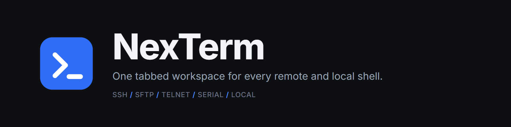
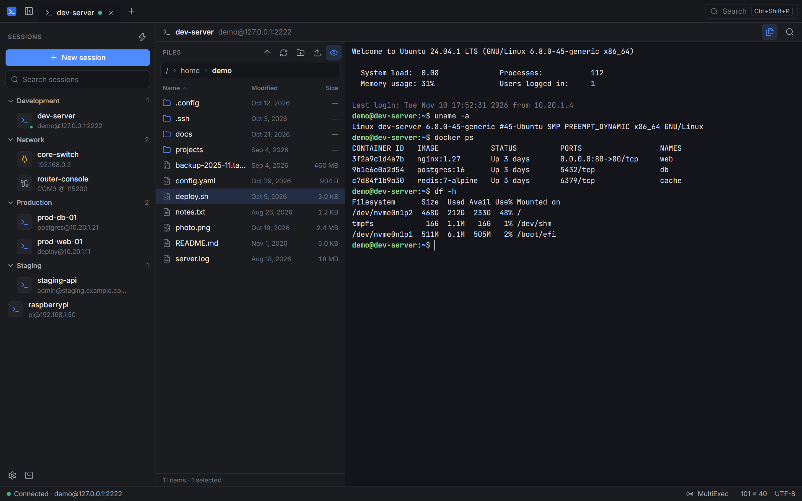
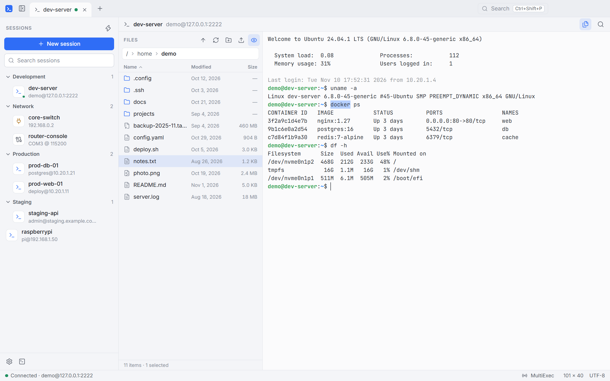
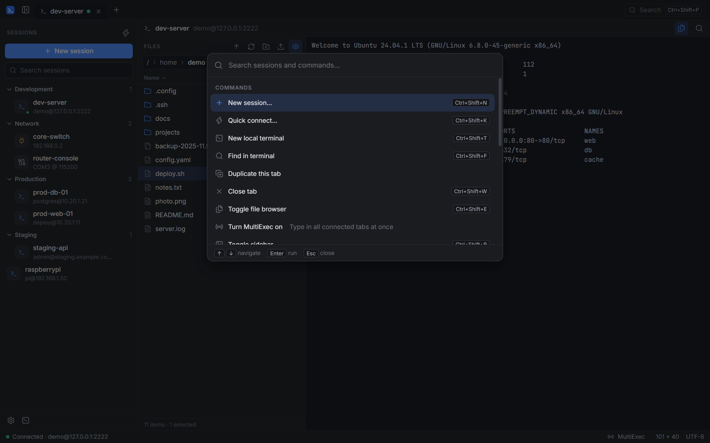
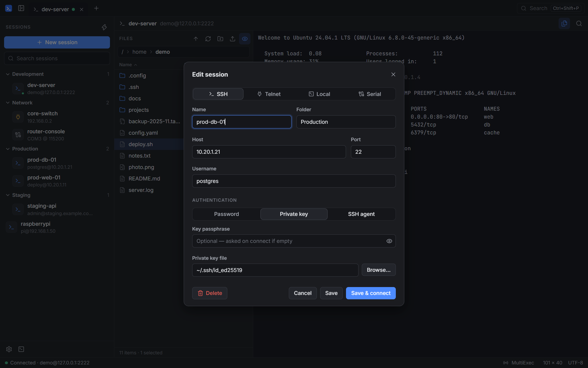

<div align="center">



<br>

[](https://github.com/ShubratoDn/NexTerm/releases)
[](LICENSE)


**A fast, secure terminal workspace.** SSH with a built-in SFTP file browser, Telnet, serial and local shells, all in one tabbed window.

[Features](#features) · [Screenshots](#screenshots) · [Getting started](#getting-started) · [Shortcuts](#keyboard-shortcuts) · [Security](#security) · [Roadmap](#roadmap) · [Contributing](CONTRIBUTING.md)

</div>

---

## Why NexTerm

Working across servers, network gear and your own machine usually means a terminal, a separate SFTP client, a serial tool and a pile of saved connections. NexTerm puts them in one window:

- **One place for every connection.** Save sessions in folders, search them instantly, and open any of them from the sidebar or the command palette.
- **Files next to the shell.** Every SSH tab can show a file browser beside the terminal, with drag-and-drop upload.
- **Built to stay out of your way.** Keyboard-first, with shortcuts that do not collide with shell and editor keys, and clear states when a connection is slow, fails, or drops.

## Features

**Sessions**
- SSH, Telnet, serial (COM / tty) and local shell sessions in tabs
- Saved sessions with folders, instant search, duplicate, and quick connect (`user@host:port`, `[::1]:2222`)
- Reconnect a dropped session in one click; a failed connection keeps its tab with *Retry* and *Edit session*

**SSH & SFTP**
- Password, private key (with passphrase prompt) and SSH agent authentication
- File browser beside the terminal: breadcrumb navigation, sortable columns, multi-select, keyboard control
- Upload (including drag and drop), download, rename, create folder, delete
- Host key verification: confirm unknown hosts, hard refusal when a known host's key changes

**Terminal**
- [xterm.js](https://xtermjs.org/) terminal with 256-colour and truecolour support, scrollback and in-terminal search
- **MultiExec**: type once, send to every connected tab (clearly flagged on the tab and in the status bar)
- Copy / paste, right-click menu, zoom, configurable font, cursor and scrollback

**Interface**
- Command palette (`Ctrl+Shift+P`) for sessions, tabs and actions
- Light, dark or system theme; bundled Inter and JetBrains Mono fonts so it looks the same everywhere
- Resizable sidebar and file browser, remembered between launches

## Screenshots

<table>
  <tr>
    <td width="50%"></td>
    <td width="50%"></td>
  </tr>
  <tr>
    <td align="center"><sub>SSH terminal with the file browser, dark theme</sub></td>
    <td align="center"><sub>Light theme</sub></td>
  </tr>
  <tr>
    <td width="50%"></td>
    <td width="50%"></td>
  </tr>
  <tr>
    <td align="center"><sub>Command palette</sub></td>
    <td align="center"><sub>Session editor with inline validation</sub></td>
  </tr>
</table>

<sub>Screenshots use a local demo server and sample session names.</sub>

## Getting started

### Download (Windows)

1. Download `NexTerm-v0.1.0-win-x64.zip` from the [Releases page](https://github.com/ShubratoDn/NexTerm/releases).
2. Extract the zip anywhere, for example `C:\Apps\NexTerm`.
3. Run `NexTerm.exe`.

It is a portable folder: no installer, nothing written outside the folder except your settings in `%APPDATA%\NexTerm`. The build is not code-signed, so Windows SmartScreen may show *Windows protected your PC*; choose **More info → Run anyway**. You can verify the download against `SHA256SUMS.txt` on the release page.

### Requirements (building from source)

- [Node.js](https://nodejs.org/) 22 or newer
- Windows 10/11 (the tested platform). macOS and Linux should work but are not tested yet; see [Platform support](#platform-support).

### Run from source

```bash
git clone https://github.com/ShubratoDn/NexTerm.git
cd NexTerm
npm install
npm start
```

If your npm blocks install scripts, Electron's binary may not have been downloaded. Run it once:

```bash
node node_modules/electron/install.js
```

### Build a release

```bash
npm run package        # portable app folder: release/NexTerm-<platform>-<arch>/
npm run release        # the folder above, zipped, plus SHA256SUMS.txt
```

### Develop

```bash
npm run typecheck      # strict TypeScript for main, preload and renderer
npm test               # unit and integration tests
npm run build          # bundle everything into dist/
npm run brand          # regenerate logos, icons, banner and social preview from assets/icon.svg
```

## Using NexTerm

| I want to… | Do this |
|---|---|
| Save a connection | **New session** (`Ctrl+Shift+N`) |
| Connect once without saving | **Quick connect** (`Ctrl+Shift+K`), then type `admin@192.168.1.10:22` |
| Open a local shell | `Ctrl+Shift+T` |
| Find anything fast | `Ctrl+Shift+P` |
| Upload files over SFTP | Drag them onto the file browser, or use the upload button |
| Run one command on many servers | Turn on **MultiExec** in the status bar, then type in any tab |

Your data lives in the app's data folder (`%APPDATA%\NexTerm` on Windows): `sessions.json`, `settings.json` and `known_hosts.json`.

## Keyboard shortcuts

| Shortcut | Action |
|---|---|
| `Ctrl+Shift+P` | Command palette |
| `Ctrl+Shift+N` | New session |
| `Ctrl+Shift+K` | Quick connect |
| `Ctrl+Shift+T` | New local terminal |
| `Ctrl+Shift+W` | Close tab |
| `Ctrl+Tab` / `Ctrl+Shift+Tab` | Next / previous tab |
| `Ctrl+Shift+B` | Show or hide the sidebar |
| `Ctrl+Shift+E` | Show or hide the file browser |
| `Ctrl+Shift+F` | Find in terminal |
| `Ctrl+Shift+C` / `Ctrl+Shift+V` | Copy / paste (`Ctrl+C` copies when text is selected) |
| `Ctrl+=` / `Ctrl+-` / `Ctrl+0` | Zoom in / out / reset |

In the file browser: `Enter` open, `Backspace` parent folder, `F2` rename, `Del` delete, `F5` refresh, `Ctrl+A` select all, `Ctrl+L` edit the path.

Application shortcuts use `Ctrl+Shift` so they never steal keys that shells and editors rely on (`Ctrl+W`, `Ctrl+K`, `Ctrl+B`, …).

## Security

NexTerm handles credentials and remote access, so the defaults are conservative. Details are in [docs/ARCHITECTURE.md](docs/ARCHITECTURE.md#security-model).

- **Host keys are verified.** An unknown host asks for confirmation (trust on first use) and the fingerprint is stored. A changed key is refused outright.
- **Saved passwords are encrypted** with the operating system's credential store through Electron `safeStorage`. If that store is unavailable, passwords are simply not saved.
- **The interface is isolated.** Context isolation and the sandbox are on, Node integration is off, a strict Content Security Policy blocks remote content, and the renderer only reaches the system through a small typed bridge.
- **Input is validated** in the main process; IPC messages must come from the app's own window.
- **No telemetry.** NexTerm makes no network connections except the ones you ask for.

To report a vulnerability, see [SECURITY.md](SECURITY.md).

## Platform support

| Platform | Status |
|---|---|
| Windows 10 / 11 | Tested |
| macOS, Linux | Not tested yet. Contributions and bug reports welcome |

## Roadmap

- [ ] SFTP-only sessions (no shell), for servers that disallow one
- [ ] SSH port forwarding and tunnels
- [ ] Split panes
- [ ] Recursive folder upload and download
- [ ] Session import / export
- [ ] Installer, code signing and auto-update
- [ ] Macros and snippets
- [ ] Remote desktop and X11 forwarding (exploratory)

Have an idea? [Open a feature request](https://github.com/ShubratoDn/NexTerm/issues/new?template=feature_request.yml).

## Project layout

```
src/main       Main process: connections (SSH, Telnet, PTY, serial), SFTP, storage, validation
src/preload    The narrow, typed bridge exposed to the UI
src/renderer   The interface: terminals, sidebar, file browser, dialogs
src/shared     Types and helpers shared by both sides
src/test       Unit and integration tests (in-process SSH, SFTP and Telnet servers)
assets         The logo source and generated icons
docs           Architecture notes and README images
```

## Contributing

Contributions are welcome. Please read [CONTRIBUTING.md](CONTRIBUTING.md) and the [Code of Conduct](CODE_OF_CONDUCT.md) first.

## Acknowledgements

NexTerm stands on excellent open-source work: [Electron](https://www.electronjs.org/), [xterm.js](https://xtermjs.org/), [ssh2](https://github.com/mscdex/ssh2), [node-pty](https://github.com/microsoft/node-pty) (via the [@lydell](https://github.com/lydell/node-pty) fork), [serialport](https://serialport.io/), [Lucide](https://lucide.dev/) icons, and the [Inter](https://rsms.me/inter/) and [JetBrains Mono](https://www.jetbrains.com/lp/mono/) typefaces. See [THIRD_PARTY_NOTICES.md](THIRD_PARTY_NOTICES.md).

## License

[MIT](LICENSE) © Shubrato Debnath
