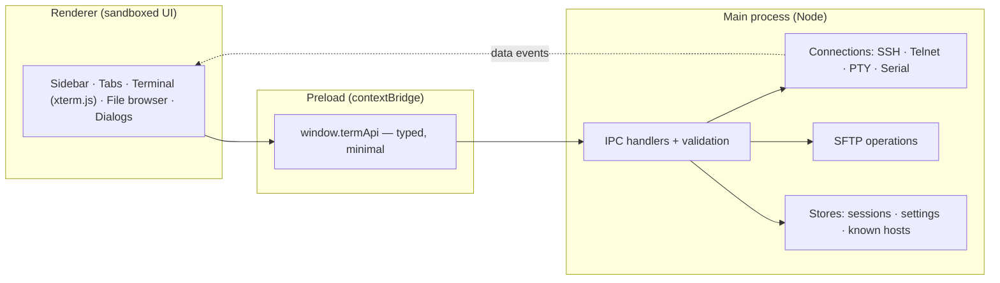
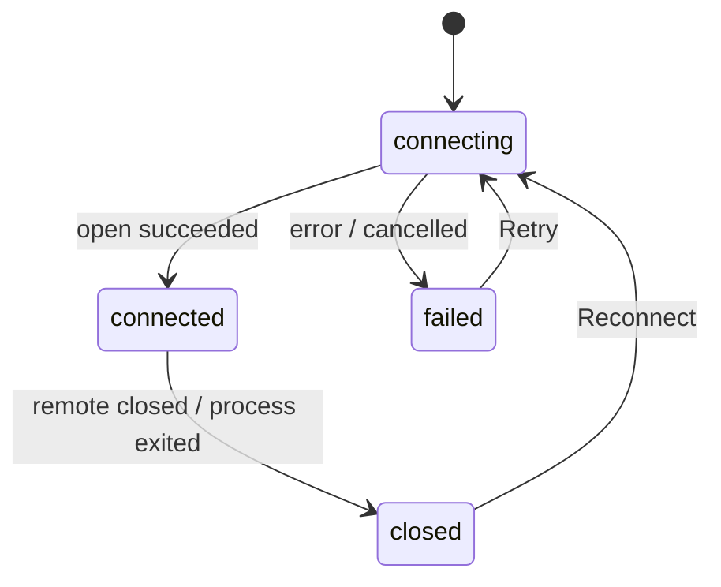

# Architecture

NexTerm is an Electron application written in strict TypeScript. This document explains how the pieces fit together and why the security-relevant decisions were made.

## Process model



| Layer | Path | Responsibility |
|---|---|---|
| Main | `src/main` | Owns every privileged capability: network, serial ports, PTYs, files, dialogs, credential storage |
| Preload | `src/preload` | Exposes `window.termApi`, a small typed API, and nothing else |
| Renderer | `src/renderer` | Pure UI. No Node access, no remote content |
| Shared | `src/shared` | Types, the API contract (`TermApi`) and pure helpers such as the quick-connect parser |

The API contract in `src/shared/api.ts` is implemented by the preload script and consumed by the renderer, so a mismatch is a compile error rather than a runtime surprise.

## Connections

Every session type is a `Conn` (`src/main/connections.ts`):

```ts
interface Conn {
  write(data: string): void;
  resize(cols: number, rows: number): void;
  close(): void;
  sftp?(): Promise<SFTPWrapper>;   // SSH only
}
```

| Type | Implementation |
|---|---|
| SSH | [`ssh2`](https://github.com/mscdex/ssh2): shell channel, keepalive, password / key / agent / keyboard-interactive |
| Telnet | `net` socket plus a small option-negotiation filter (`src/main/telnet-filter.ts`: ECHO, SGA, terminal type, window size) |
| SFTP only | The same `ssh2` connection, but only the file-transfer subsystem is opened (no shell); the connect fails clearly if the server has no SFTP |
| Local | PTY through `@lydell/node-pty` (ConPTY on Windows) |
| Serial | [`serialport`](https://serialport.io/) |

Data flows from a `Conn` to the renderer as binary `conn:data` events and back through `conn:write`. The renderer buffers data that arrives before its tab knows the connection id, so nothing is lost during connect.

### Connection lifecycle in the UI



A tab is created immediately in `connecting`, so the terminal has a real size before the connection opens. A failed connection keeps its tab with *Retry* and *Edit session*; a dropped one shows a *Reconnect* banner over the preserved scrollback.

## SFTP

The file browser is a renderer component (`src/renderer/sftp-pane.ts`) backed by main-process operations (`src/main/sftp.ts`). It reuses the SSH connection of its tab, so it needs no second login.

- Directory listings sort folders first; a stale response from a superseded navigation is discarded.
- Downloads of several files ask for one destination folder and never overwrite: `name.txt` becomes `name (1).txt`.
- Remote names that come from the UI must be a single path component (no `/`, `\`, `.` or `..`).

## IPC channels

| Channel | Direction | Purpose |
|---|---|---|
| `sessions:*`, `settings:*` | invoke | Saved sessions and preferences |
| `conn:open` | invoke | Open a connection; resolves with its id |
| `conn:write`, `conn:resize`, `conn:close` | send | Input, terminal size, close |
| `conn:data`, `conn:closed` | main → renderer | Output and lifecycle |
| `sftp:*` | invoke | List, transfer, rename, create, delete |
| `import:detect`, `import:pick`, `import:preview`, `import:commit` | invoke | Find, preview and import connections from other tools |
| `drop:register` | send | Registers a file the user dropped on the window |
| `ui:titlebar` | send | Syncs the native caption-button colours with the theme |

## Security model

1. **Isolation.** `contextIsolation: true`, `sandbox: true`, `nodeIntegration: false`. Navigation and new windows are denied; all permission requests are refused.
2. **Content Security Policy.** `default-src 'none'`; scripts, styles, fonts and images only from the app itself. Fonts and icons are bundled, so nothing is fetched at runtime.
3. **Sender check.** Every IPC handler verifies the request originates from the app's own page.
4. **Validation in main.** Session definitions, settings, terminal sizes and paths are validated before use (`src/main/validate.ts`). The renderer is never trusted to send well-formed data.
5. **Secrets.** Passwords are encrypted with `safeStorage` (DPAPI on Windows, Keychain on macOS, libsecret on Linux) before touching disk; if encryption is unavailable they are not persisted. Secrets are never sent back to the renderer: it only learns `hasPassword`.
6. **Host keys.** `known_hosts.json` stores SHA-256 fingerprints. Unknown host: the user must confirm. Changed key: the connection is refused and the specific reason is shown.
7. **Drag-and-drop uploads.** The preload script registers the path of each file the user actually dropped; the main process uploads only registered paths, once. A compromised page cannot ask it to read arbitrary files.
8. **Importing connections.** Parsers in `src/main/importers` are pure functions that read only connection fields (name, host, port, user, key *path*, folder). Passwords and other sections of the source files are never read. The main process only opens a file that it detected itself or that the user chose in the native file dialog (an allow-list of resolved paths), caps file size, and validates every imported session with the same rules as a hand-made one.
9. **Fail closed.** Opening a connection that was closed or retried while pending closes the late connection instead of adopting it.

## Testing

`npm test` runs the Node test runner against the compiled output:

- **Unit:** Telnet negotiation (including split packets and escaping), input validation, the quick-connect parser, file-name helpers.
- **Integration:** an in-process SSH server (password auth, shell, SFTP subsystem) and a Telnet server exercise the real connection code, host-key callback and failure paths.

The renderer is verified by driving the built application through the Chrome DevTools protocol (real mouse and keyboard events). That harness is not part of the repository yet; adding an automated end-to-end suite is on the roadmap.

## Build

- `tsc` compiles main, preload and tests to `dist/`.
- `esbuild` bundles the renderer into `dist/renderer/app.js` and copies HTML, CSS, fonts and the logo.
- `scripts/package.mjs` produces a portable folder with `@electron/packager`. Native add-ons are loaded from disk, so the app is not packed into an asar archive.
- `scripts/package-linux.mjs` produces Linux packages with `electron-builder` (config in `electron-builder.config.cjs`). On Windows/macOS it first stages a copy of the app with the Linux build of `node-pty` installed (`npm ci --os=linux`), because a Windows `node_modules` only contains Windows binaries, and it re-creates the `.tar.gz` with explicit Unix permissions since Windows cannot record them.
- `scripts/make-brand.cjs` renders every logo asset from `assets/icon.svg`, the single source of the mark.
